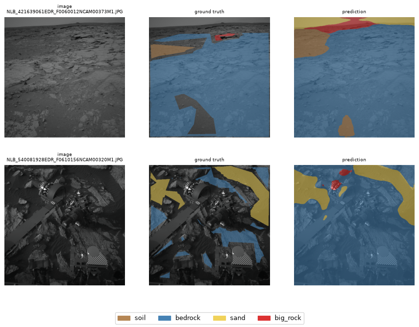
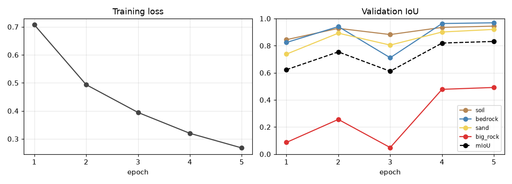
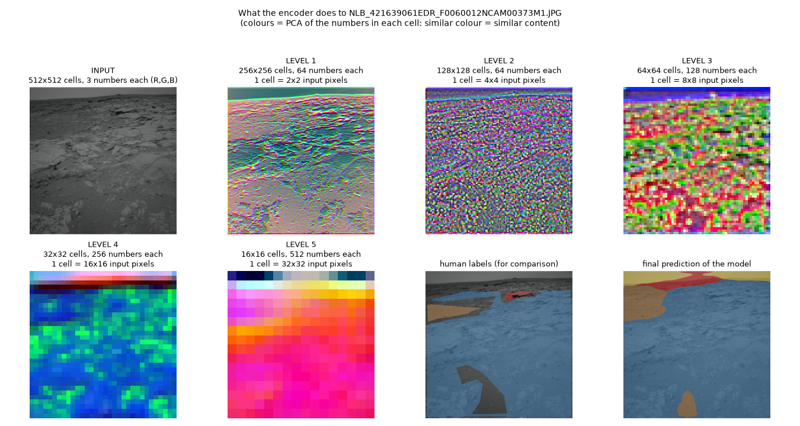

# Mars Terrain Segmentation

A U-Net that labels every pixel of a Mars rover photo as **soil**, **bedrock**, **sand** or **big rock**.
Trained on Curiosity NavCam images from the [AI4Mars](https://www.zooniverse.org/projects/hiro-ono/ai4mars) dataset, in PyTorch.
It is a personal learning project: a small, readable baseline, trained for only 5 epochs (~1 hour on a MacBook).



*Left to right: image, human labels, model prediction. Uncoloured pixels in the labels are unlabelled (rover, far away, ambiguous): the model is never trained or scored there.*

## Results

Evaluated on the **322 expert-labelled test images**, never used for training or for choosing the checkpoint,
at full 1024×1024 resolution. `min1/min2/min3` = how many of the 3 experts must agree on a pixel to keep it
(`min3` keeps only the unambiguous, easier pixels).

| Test labels | mIoU | soil | bedrock | sand | big rock |
|-------------|------|------|---------|------|----------|
| min1        | 0.660 | 0.910 | 0.791 | 0.835 | 0.104 |
| min2        | 0.704 | 0.957 | 0.865 | 0.906 | 0.088 |
| min3        | 0.781 | 0.979 | 0.915 | 0.942 | 0.290 |

IoU = intersection over union, per class (1.0 is perfect). `evaluate_test.py` also writes the full confusion matrices to `outputs/<run>/test_report.txt`.



The loss is still falling and the validation mIoU still rising at epoch 5 (0.83), so the model is under-trained: more epochs should help.

## How it works

- **Model:** U-Net with a ResNet34 encoder pre-trained on ImageNet ([segmentation-models-pytorch](https://github.com/qubvel-org/segmentation_models.pytorch)), input resized to 512×512.
- **Loss:** class-weighted cross-entropy + 0.5 × Dice. Unlabelled pixels (value 255) are ignored.
- **Optimiser:** AdamW, learning rate 3e-4 with cosine decay, batch size 8.
- **Augmentation:** random crop, horizontal flip, brightness/contrast.
- **Split:** images are grouped by acquisition time (blocks of 5 Martian days) before splitting into train/validation, because consecutive photos are nearly identical and a random split would leak.

## Data

| Split | Images | Labels |
|-------|--------|--------|
| Train | 14,309 | crowd-sourced, merged |
| Validation | 1,592 | crowd-sourced, merged |
| Test | 322 | expert |

163 images with no labelled pixel at all were dropped. About 44% of all pixels are unlabelled.
Classes are very imbalanced: of the labelled pixels, 37.5% are soil, 49.5% bedrock, 12.1% sand and only **0.9% big rock**.

## Run it

Requires [uv](https://docs.astral.sh/uv/). Download the AI4Mars merged dataset (v0.6) into `data/raw/ai4mars-dataset-merged-0.6/`, then:

```bash
uv sync
uv run python scripts/make_splits.py \
  --img-dir data/raw/ai4mars-dataset-merged-0.6/msl/ncam/images/edr \
  --mask-dir data/raw/ai4mars-dataset-merged-0.6/msl/ncam/labels/train
uv run python train.py --run-name quick                    # settings in config.yaml
uv run python evaluate_test.py --run outputs/quick         # expert test set
uv run python visualize.py --split val --run outputs/quick # prediction grid
uv run python scripts/plot_training.py --run outputs/quick # training curves
```

`train.py --smoke` runs a few batches only, to check the pipeline; `--resume outputs/quick` continues an interrupted run.
The code uses an NVIDIA GPU, Apple GPU (MPS) or CPU, whichever is available.

## Project structure

| File | Purpose |
|------|---------|
| `config.yaml` | all settings: paths, model, hyperparameters |
| `scripts/make_splits.py` | time-grouped train/validation split |
| `dataset.py`, `augmentation.py` | loading images + masks, augmentations |
| `train.py` | training loop, checkpoints, logging |
| `metrics.py` | confusion matrix, IoU, mIoU |
| `evaluate_test.py`, `evaluate.py` | evaluation on the test set / on any folder |
| `visualize.py`, `scripts/plot_training.py` | prediction grids and training curves |

## Limitations and next steps

- **Big rock is weak** (IoU 0.1–0.3) because of false positives, not missed rocks: the model finds 68–100% of the real big-rock pixels, but also labels 2–3% of bedrock as big rock. Bedrock is about half of the labelled pixels and big rock under 1%, so these false positives outnumber the correct ones.
- Only 5 epochs and no hyperparameter search. Next: a longer run, a lower big-rock class weight, and losses that penalise false positives more (e.g. Tversky, Lovász).
- Predictions on unlabelled areas (sky, rover) are meaningless, as the model never gets a training signal there.

## Learning Notes

## Credits

Dataset: **AI4Mars**, by NASA JPL and the Zooniverse community labelers. Check the dataset page for its license and citation terms.
