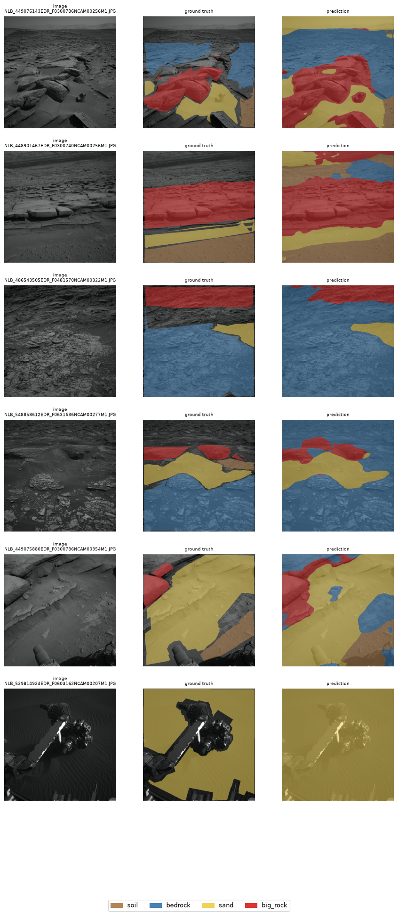
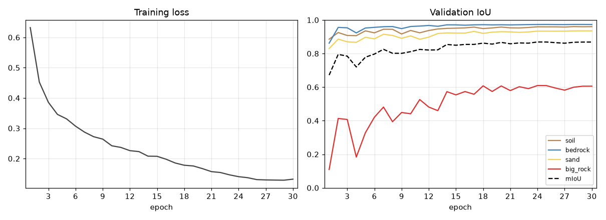
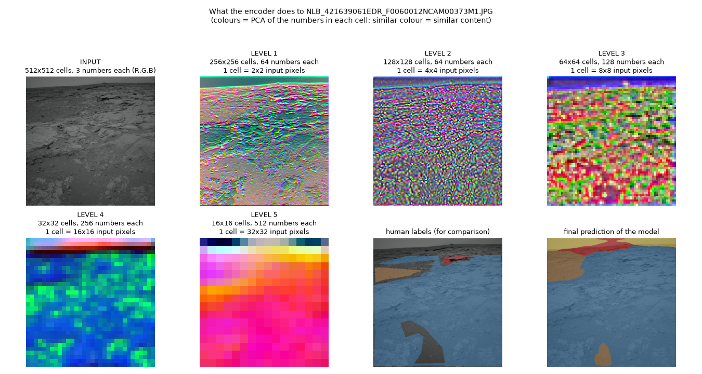

# Mars Terrain Segmentation

A U-Net that labels every pixel of a Mars rover photo as **soil**, **bedrock**, **sand** or **big rock**.
Trained on Curiosity NavCam images from the [AI4Mars](https://www.zooniverse.org/projects/hiro-ono/ai4mars) dataset, in PyTorch.



*Left to right: image, human labels, model prediction. Uncoloured pixels in the labels are unlabelled (rover, far away, ambiguous): the model is never trained or scored there.*

## Results

Evaluated once on the **322 expert-labelled test images** at full 1024×1024 resolution. `min1/min2/min3` = how many of the 3 experts must agree on a pixel to keep it
(`min3` keeps only the unambiguous pixels).

| Test labels | mIoU | soil | bedrock | sand | big rock |
|-------------|------|------|---------|------|----------|
| min1        | 0.670 | 0.915 | 0.805 | 0.851 | 0.109 |
| min2        | 0.717 | 0.960 | 0.877 | 0.922 | 0.110 |
| min3        | 0.810 | 0.981 | 0.929 | 0.958 | 0.372 |

Final model: 30 epochs, cross-entropy + Dice, big-rock class weight 1.0. The first baseline (5 epochs, big-rock weight 2.6)
scored 0.660 / 0.704 / 0.781 mIoU and 0.104 / 0.088 / 0.290 on big rock.
IoU = intersection over union, per class (1.0 is perfect). `evaluate_test.py` writes precision, recall and confusion matrices to `outputs/<run>/test_report.txt`.



Validation mIoU plateaus at about 0.87 from epoch ~20: more epochs would not help.

## What I tried and why

**Problem.** The baseline was good on soil, bedrock and sand but weak on big rock. Precision and recall showed why:
it found most real rocks (recall 68–100%) but labelled 2–3% of bedrock as big rock. Bedrock is half the labelled pixels
and big rock about 0.1% of the test pixels, so these false positives dominate the big-rock IoU.

**Hypotheses.** (A) The big-rock class weight (2.6) pushes the model to call ambiguous pixels "rock": with weighted
cross-entropy a pixel is labelled big rock when its rock probability exceeds w_bedrock / (w_bedrock + w_rock) ≈ 11%.
(B) The loss does not penalise false positives enough.

**Ablation.** Five 5-epoch runs on an RTX 4090, changing one thing at a time, compared on the **validation** set (single seed):

| Run | Change | val mIoU | big rock IoU | precision | recall |
|-----|--------|----------|--------------|-----------|--------|
| `ce_dice` | baseline | 0.834 | 0.502 | 0.594 | 0.765 |
| `ce_dice_rock1` | big-rock weight 2.6 → 1.0 (A) | **0.838** | **0.517** | **0.658** | 0.707 |
| `ce_tversky` | Dice → Tversky, α=0.7 on false positives (B) | 0.832 | 0.495 | 0.586 | 0.761 |
| `ce_lovasz` | Dice → Lovász (optimises IoU directly) | 0.828 | 0.480 | 0.577 | 0.741 |
| `focal_dice` | cross-entropy → focal loss | 0.812 | 0.433 | 0.496 | 0.771 |

The mIoU gaps are small (single seed), but the lower weight moved precision up and recall down exactly as (A) predicts,
with no class getting worse. Changing the loss did not help: the cause was the weight, not the loss. That setting was trained for 30 epochs.

**Outcome on the test set.** All classes improved. On big rock, false positives on bedrock fell from 2.9% to 2.1% (min1)
and IoU on unambiguous rocks (min3) rose from 0.29 to 0.37, with 99.7% recall. On min1 the more cautious model misses
ambiguous rocks (recall 68% → 51%), so the IoU stays about the same. The validation gain only partly transfers, likely
because crowd-sourced (train) and expert (test) labels disagree on what counts as a big rock, and because big rock is
about 6× rarer in the test set.

## How it works

- **Model:** U-Net with a ResNet34 encoder pre-trained on ImageNet ([segmentation-models-pytorch](https://github.com/qubvel-org/segmentation_models.pytorch)), input resized to 512×512.
- **Loss:** class-weighted cross-entropy + 0.5 × Dice; unlabelled pixels (value 255) are ignored. Other combinations (`ce_tversky`, `ce_lovasz`, `focal_dice`, ...) are selectable in `config.yaml`.
- **Optimiser:** AdamW, learning rate 3e-4 with cosine decay, batch size 8. bf16 mixed precision on NVIDIA GPUs.
- **Augmentation:** random crop, horizontal flip, brightness/contrast.
- **Split:** images are grouped by acquisition time (blocks of 5 Martian days) before splitting into train/validation, because consecutive photos are nearly identical and a random split would leak.
- **Method:** all choices made on validation; the test set is used once, on the final model.

## Data

| Split | Images | Labels |
|-------|--------|--------|
| Train | 14,309 | crowd-sourced, merged |
| Validation | 1,592 | crowd-sourced, merged |
| Test | 322 | expert |

163 images with no labelled pixel at all were dropped. About 44% of all pixels are unlabelled.
Classes are very imbalanced: of the labelled pixels, 37.5% are soil, 49.5% bedrock, 12.1% sand and only **0.9% big rock**.

## Run it

Requires [uv](https://docs.astral.sh/uv/). Download the AI4Mars merged dataset (v0.6) into `data/raw/ai4mars-dataset-merged-0.6/`, then:

```bash
uv sync
uv run python scripts/make_splits.py \
  --img-dir data/raw/ai4mars-dataset-merged-0.6/msl/ncam/images/edr \
  --mask-dir data/raw/ai4mars-dataset-merged-0.6/msl/ncam/labels/train
uv run python train.py --run-name quick                      # settings in config.yaml
uv run python evaluate_test.py --run outputs/quick           # expert test set
uv run python visualize.py --split val --run outputs/quick   # prediction grid
uv run python scripts/plot_training.py --run outputs/quick   # training curves
```

Change settings for one run with `--set`, e.g. the final model:

```bash
uv run python train.py --run-name long --set train.epochs=30 train.loss=ce_dice "train.class_weights=[0.369,0.317,0.7,1.0]"
```

`train.py --smoke` runs a few batches only, to check the pipeline; `--resume outputs/quick` continues an interrupted run.
The code uses an NVIDIA GPU, Apple GPU (MPS) or CPU, whichever is available. 

## Project structure

| File | Purpose |
|------|---------|
| `config.yaml` | all settings: paths, model, loss, hyperparameters |
| `scripts/make_splits.py` | time-grouped train/validation split |
| `dataset.py`, `augmentation.py` | loading images + masks, augmentations |
| `train.py` | training loop, checkpoints, logging, `--set` overrides |
| `losses.py` | configurable loss: cross-entropy / focal + Dice / Tversky / Lovász |
| `metrics.py` | confusion matrix, IoU, precision, recall |
| `evaluate_test.py`, `evaluate.py` | evaluation on the test set / on any folder |
| `visualize.py`, `scripts/plot_training.py` | prediction grids and training curves |

## Limitations and next steps

- **Big rock is still weak on the test set** (IoU 0.11 on min1), for the reasons above.
- Next: tune the big-rock decision threshold on validation (a bias on its logit, no retraining); train at full 1024 resolution, since small rocks lose detail at 512; repeat the ablation with more seeds.
- Predictions on unlabelled areas (sky, rover) are meaningless, as the model never gets a training signal there.

## Learning Notes



## Credits

Dataset: **AI4Mars**, by NASA JPL and the Zooniverse community labelers. Check the dataset page for its license and citation terms.
